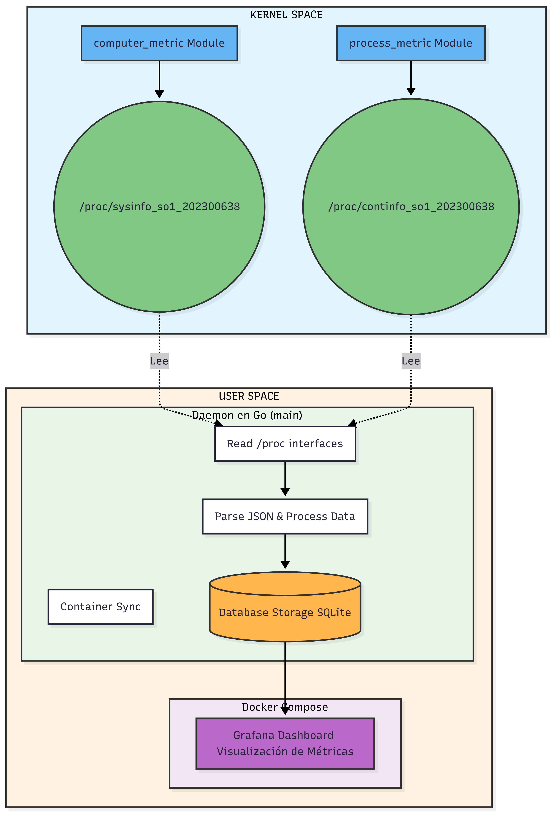

# MANUAL TÉCNICO - SISTEMA DE MONITOREO DE CONTENEDORES

## Proyecto SOPES1 - Carnet: 202300638

---

## Tabla de Contenidos

1. [Introducción](#introducción)
2. [Arquitectura del Sistema](#arquitectura-del-sistema)
3. [Módulos de Kernel](#módulos-de-kernel)
4. [Daemon en Go](#daemon-en-go)
5. [Integración con Docker](#integración-con-docker)
6. [Sistema de Visualización](#sistema-de-visualización)
7. [Instalación y Configuración](#instalación-y-configuración)
8. [Comandos de Ejecución](#comandos-de-ejecución)
9. [Consideraciones Técnicas](#consideraciones-técnicas)
10. [Resolución de Problemas](#resolución-de-problemas)

---

## 1. Introducción

Este proyecto implementa un sistema completo de monitoreo de contenedores Docker utilizando módulos del kernel de Linux, un daemon desarrollado en Go, y visualización con Grafana. El sistema es capaz de extraer métricas del sistema operativo y de procesos en ejecución directamente desde el kernel de Linux.

### Objetivos del Proyecto

1. **Desarrollar módulos de kernel funcionales** que puedan cargarse/descargarse dinámicamente
2. **Extraer información de procesos** desde estructuras internas del kernel
3. **Crear interfaces virtuales en /proc** para exponer información del kernel
4. **Implementar un daemon en Go** que lea y parsee la información del kernel

---

## 2. Arquitectura del Sistema



### 2.1 Componentes Principales

### 2.2 Flujo de Datos

1. **Módulos del Kernel** extraen información en tiempo real
2. **Interfaces /proc** exponen datos en formato JSON
3. **Daemon Go** lee y parsea información periódicamente
4. **Base de Datos SQLite** almacena histórico de métricas
5. **Grafana** visualiza datos en tiempo real

---

## 3. Módulos de Kernel

### 3.1 Objetivo 1: Desarrollo de Módulos de Kernel

Los módulos de kernel son componentes que extienden la funcionalidad del kernel de Linux sin necesidad de recompilar todo el kernel. Este proyecto implementa dos módulos principales.

#### 3.1.1 Módulo: computer_metric

**Ubicación:** `kernel_modules/metric_computer_module/computer_metric.c`

**Funcionalidad:**

- Recolecta información del sistema (RAM, CPU, Swap)
- Crea interfaz virtual en `/proc/sysinfo_so1_202300638`
- Genera salida en formato JSON

**Estructuras y Funciones Principales:**

```c
// Estructura para información del sistema
struct sysinfo si;

// Función principal que genera la salida JSON
static int sysinfo_show(struct seq_file *m, void *v) {
    si_meminfo(&si);  // Obtiene información de memoria

    // Cálculos de memoria
    available_ram = (si.freeram + (si.bufferram * 3)) * 4096;
    free_ram = si.freeram * 4096;
    used_ram = (si.totalram - si.freeram - (si.bufferram * 3)) * 4096;

    // Generación de JSON
    seq_printf(m, "{\n");
    seq_printf(m, "  \"Totalram\": %lu,\n", si.totalram * 4096);
    // ... más campos
    seq_printf(m, "}\n");
}
```

**Campos Exportados:**

- `Totalram`: Memoria RAM total del sistema
- `Freeram`: Memoria RAM libre
- `Available`: Memoria disponible (libre + buffers)
- `Usedram`: Memoria en uso
- `Sharedram`: Memoria compartida
- `Bufferram`: Memoria en buffers
- `Totalswap`: Espacio swap total
- `Freeswap`: Espacio swap libre
- `Procs`: Número de CPUs en línea
- `cpu_user`, `cpu_nice`, `cpu_system`, `cpu_idle`: Estadísticas de CPU

**Compilación:**

```makefile
obj-m += computer_metric.o

all:
	make -C /lib/modules/$(shell uname -r)/build M=$(PWD) modules

clean:
	make -C /lib/modules/$(shell uname -r)/build M=$(PWD) clean
```

#### 3.1.2 Módulo: process_metric

**Ubicación:** `kernel_modules/metric_process_module/process_metric.c`

**Funcionalidad:**

- Recorre todas las estructuras de procesos del kernel
- Extrae información detallada de cada proceso
- Identifica procesos que corren dentro de contenedores Docker
- Crea interfaz virtual en `/proc/continfo_so1_202300638`

### 3.2 Objetivo 2: Extracción de Información de Procesos

El módulo `process_metric` accede a las estructuras internas del kernel para extraer información de procesos:

**Estructuras del Kernel Utilizadas:**

```c
#include <linux/sched.h>         // task_struct
#include <linux/sched/signal.h>  // for_each_process
#include <linux/sched/mm.h>      // get_task_mm
#include <linux/mm.h>            // mm_struct
```

**Proceso de Extracción:**

```c
// Recorrer todos los procesos del sistema
for_each_process(task) {
    // Obtener PID
    pid = task->pid;

    // Obtener nombre del comando
    get_task_comm(comm, task);

    // Obtener línea de comandos completa
    cmdline = get_process_cmdline(task);

    // Obtener uso de memoria
    if (task->mm) {
        rss = get_mm_rss(task->mm) << (PAGE_SHIFT - 10); // KB
        vsz = task->mm->total_vm << (PAGE_SHIFT - 10);    // KB
    }

    // Detectar si es un contenedor Docker
    is_docker = is_docker_container(task);
}
```

**Función para Detectar Contenedores:**

```c
static bool is_docker_container(struct task_struct *task) {
    // Verifica si el proceso corre en un namespace de contenedor
    // Compara los namespaces con el proceso init
}
```

**Información Extraída por Proceso:**

- `PID`: Process ID
- `Name`: Nombre del proceso
- `Cmdline`: Línea de comandos completa
- `Vsz`: Memoria virtual (KB)
- `Rss`: Memoria residente (KB)
- `MemoryPercent`: Porcentaje de memoria utilizada
- `User`: Usuario que ejecuta el proceso
- `State`: Estado del proceso (Running, Sleeping, etc.)
- `Container_id`: ID del contenedor Docker (si aplica)

### 3.3 Objetivo 3: Interfaz de Kernel en /proc

#### 3.3.1 ¿Qué es /proc?

`/proc` es un sistema de archivos virtual en Linux que proporciona una interfaz para acceder a información del kernel. No contiene archivos "reales" en disco, sino interfaces que el kernel genera dinámicamente.

#### 3.3.2 Creación de Archivos en /proc

**Estructura proc_ops:**

```c
static const struct proc_ops sysinfo_ops = {
    .proc_open = sysinfo_open,     // Se llama al abrir el archivo
    .proc_read = seq_read,          // Se llama al leer el archivo
};
```

**Inicialización del Módulo:**

```c
static int __init sysinfo_init(void) {
    // Crear entrada en /proc
    proc_create(PROC_NAME, 0, NULL, &sysinfo_ops);
    printk(KERN_INFO "Modulo sysinfo cargado\n");
    return 0;
}
```

**Limpieza al Descargar el Módulo:**

```c
static void __exit sysinfo_exit(void) {
    // Remover entrada de /proc
    remove_proc_entry(PROC_NAME, NULL);
    printk(KERN_INFO "Modulo sysinfo descargado\n");
}
```

**Macros del Kernel:**

```c
module_init(sysinfo_init);   // Define función de inicio
module_exit(sysinfo_exit);   // Define función de salida
```

#### 3.3.3 Formato de Salida JSON

Ambos módulos generan salida en formato JSON para facilitar el parsing desde espacio de usuario:

**Ejemplo de /proc/sysinfo_so1_202300638:**

```json
{
  "Totalram": 16777216,
  "Freeram": 8388608,
  "Available": 10485760,
  "Usedram": 6291456,
  "Procs": 8,
  "cpu_user": 12345,
  "cpu_system": 6789
}
```

**Ejemplo de /proc/continfo_so1_202300638:**

```json
{
  "processes": [
    {
      "PID": 1234,
      "Name": "nginx",
      "Cmdline": "nginx: master process",
      "Vsz": 102400,
      "Rss": 51200,
      "MemoryPercent": 2.5,
      "Container_id": "abc123def456"
    }
  ]
}
```

### 3.4 Estructura del Módulo

#### 3.4.1 Organización de Archivos y Directorios

**Módulo computer_metric:**

```
kernel_modules/metric_computer_module/
├── computer_metric.c          # Código fuente del módulo
├── Makefile                   # Archivo de compilación
├── execute_computer_metric.sh # Script de ejecución
├── computer_metric.ko         # Módulo compilado (generado)
├── computer_metric.mod        # Archivo de módulo (generado)
├── computer_metric.mod.c      # Código de módulo (generado)
├── Module.symvers             # Símbolos exportados (generado)
└── modules.order              # Orden de módulos (generado)
```

**Módulo process_metric:**

```
kernel_modules/metric_process_module/
├── process_metric.c           # Código fuente del módulo
├── Makefile                   # Archivo de compilación
├── execute_computer_process.sh # Script de ejecución
├── process_metric.ko          # Módulo compilado (generado)
├── process_metric.mod         # Archivo de módulo (generado)
├── process_metric.mod.c       # Código de módulo (generado)
├── Module.symvers             # Símbolos exportados (generado)
└── modules.order              # Orden de módulos (generado)
```

#### 3.4.2 Funciones Principales y su Propósito

**Módulo computer_metric:**

| Función          | Propósito                                                                                  |
| ---------------- | ------------------------------------------------------------------------------------------ |
| `sysinfo_show()` | Función principal que recolecta información del sistema (RAM, CPU) y la formatea como JSON |
| `sysinfo_open()` | Callback que se ejecuta cuando se abre el archivo /proc, inicializa la lectura             |
| `sysinfo_init()` | Función de inicialización del módulo, crea el archivo /proc                                |
| `sysinfo_exit()` | Función de limpieza, elimina el archivo /proc al descargar el módulo                       |
| `si_meminfo()`   | Función del kernel que obtiene información de memoria del sistema                          |

**Módulo process_metric:**

| Función                  | Propósito                                                      |
| ------------------------ | -------------------------------------------------------------- |
| `continfo_show()`        | Función principal que recorre todos los procesos y genera JSON |
| `get_process_cmdline()`  | Extrae la línea de comandos completa de un proceso             |
| `print_escaped_string()` | Escapa caracteres especiales para formato JSON válido          |
| `is_docker_container()`  | Detecta si un proceso pertenece a un contenedor Docker         |
| `get_container_id()`     | Obtiene el ID del contenedor Docker desde cgroup               |
| `continfo_open()`        | Callback de apertura del archivo /proc                         |
| `continfo_init()`        | Inicializa el módulo y crea /proc/continfo_so1_202300638       |
| `continfo_exit()`        | Limpieza al descargar el módulo                                |

#### 3.4.3 Dependencias Externas

**Headers del Kernel Requeridos:**

```c
#include <linux/module.h>      // Funciones básicas de módulos
#include <linux/kernel.h>       // printk y macros del kernel
#include <linux/init.h>         // Macros __init y __exit
#include <linux/proc_fs.h>      // Sistema de archivos /proc
#include <linux/seq_file.h>     // Interfaz seq_file para /proc
#include <linux/mm.h>           // Gestión de memoria
#include <linux/sched.h>        // Estructuras de procesos
#include <linux/sched/signal.h> // Iteración de procesos
#include <linux/sched/mm.h>     // Acceso a memoria de procesos
#include <linux/uaccess.h>      // Acceso a espacio de usuario
```

**Requisitos del Sistema:**

- Linux kernel 5.x o 6.x
- Headers del kernel instalados: `linux-headers-$(uname -r)`
- Herramientas de compilación: `build-essential`
- Soporte para módulos cargables en el kernel

### 3.5 Compilación del Módulo

#### 3.5.1 Instrucciones Paso a Paso

**Paso 1: Verificar Requisitos**

```bash
# Verificar versión del kernel
uname -r

# Verificar que existen los headers
ls /lib/modules/$(uname -r)/build

# Si no existen, instalarlos
sudo apt install linux-headers-$(uname -r)
```

**Paso 2: Compilar Módulo computer_metric**

```bash
# Navegar al directorio del módulo
cd kernel_modules/metric_computer_module/

# Limpiar compilaciones anteriores
make clean

# Compilar el módulo
make

# Verificar que se generó el archivo .ko
ls -lh computer_metric.ko
```

**Paso 3: Compilar Módulo process_metric**

```bash
# Navegar al directorio del módulo
cd kernel_modules/metric_process_module/

# Limpiar compilaciones anteriores
make clean

# Compilar el módulo
make

# Verificar que se generó el archivo .ko
ls -lh process_metric.ko
```

**Paso 4: Verificar Compilación**

```bash
# Ver información del módulo compilado
modinfo kernel_modules/metric_computer_module/computer_metric.ko
modinfo kernel_modules/metric_process_module/process_metric.ko

# Verificar compatibilidad con el kernel actual
modinfo computer_metric.ko | grep vermagic
```

**Salida Esperada:**

```
filename:       computer_metric.ko
license:        GPL
description:    Modulo para leer informacion de memoria y CPU
author:         Tu Nombre
version:        1.0
vermagic:       6.x.x SMP mod_unload modversions
```

### 3.6 Carga y Descarga del Módulo

#### 3.6.1 Comandos para Cargar Módulos

**Cargar con insmod:**

```bash
# Cargar módulo computer_metric
sudo insmod kernel_modules/metric_computer_module/computer_metric.ko

# Cargar módulo process_metric
sudo insmod kernel_modules/metric_process_module/process_metric.ko
```

**Cargar con modprobe (alternativa):**

```bash
# Copiar módulos al directorio del sistema
sudo cp kernel_modules/metric_computer_module/computer_metric.ko /lib/modules/$(uname -r)/
sudo cp kernel_modules/metric_process_module/process_metric.ko /lib/modules/$(uname -r)/

# Actualizar dependencias
sudo depmod -a

# Cargar módulos
sudo modprobe computer_metric
sudo modprobe process_metric
```

#### 3.6.2 Verificación de Carga Correcta

**Comando 1: Verificar con lsmod**

```bash
# Listar módulos cargados y filtrar
lsmod | grep -E "computer_metric|process_metric"
```

**Salida Esperada:**

```
process_metric         16384  0
computer_metric        16384  0
```

**Comando 2: Verificar archivos /proc**

```bash
# Verificar que se crearon los archivos
ls -l /proc/sysinfo_so1_202300638
ls -l /proc/continfo_so1_202300638
```

**Salida Esperada:**

```
-r--r--r-- 1 root root 0 Dec 13 10:30 /proc/sysinfo_so1_202300638
-r--r--r-- 1 root root 0 Dec 13 10:30 /proc/continfo_so1_202300638
```

**Comando 3: Verificar logs del kernel con dmesg**

```bash
# Ver mensajes recientes del kernel
dmesg | tail -20

# Filtrar mensajes específicos de los módulos
dmesg | grep -E "sysinfo|continfo"
```

**Salida Esperada:**

```
[12345.678901] Modulo sysinfo cargado
[12345.679012] Modulo continfo cargado
```

#### 3.6.3 Comandos para Descargar Módulos

**Descargar con rmmod:**

```bash
# Descargar módulo process_metric (primero)
sudo rmmod process_metric

# Descargar módulo computer_metric
sudo rmmod computer_metric

# Verificar descarga
lsmod | grep -E "computer_metric|process_metric"
```

**Verificar en dmesg:**

```bash
dmesg | tail -10
```

**Salida Esperada:**

```
[12567.890123] Modulo continfo descargado
[12567.890234] Modulo sysinfo descargado
```

**Verificar eliminación de archivos /proc:**

```bash
# Estos comandos deben dar error "No such file"
ls -l /proc/sysinfo_so1_202300638
ls -l /proc/continfo_so1_202300638
```

### 3.7 Pruebas y Verificación

#### 3.7.1 Cómo Probar el Módulo computer_metric

**Prueba 1: Leer información con cat**

```bash
# Leer y mostrar el JSON completo
cat /proc/sysinfo_so1_202300638
```

**Salida Esperada:**

```json
{
  "Totalram": 16777216000,
  "Freeram": 8388608000,
  "Available": 10485760000,
  "Usedram": 6291456000,
  "Sharedram": 524288000,
  "Bufferram": 1048576000,
  "Totalswap": 2147483648,
  "Freeswap": 2147483648,
  "Procs": 8,
  "cpu_user": 123456,
  "cpu_nice": 12345,
  "cpu_system": 67890,
  "cpu_idle": 234567,
  "cpu_iowait": 0,
  "cpu_irq": 0,
  "cpu_softirq": 0
}
```

**Prueba 2: Validar formato JSON**

```bash
# Validar que sea JSON válido con jq
cat /proc/sysinfo_so1_202300638 | jq .

# Extraer campos específicos
cat /proc/sysinfo_so1_202300638 | jq '.Totalram, .Usedram'
```

**Prueba 3: Monitorear en tiempo real**

```bash
# Ver cambios cada 2 segundos
watch -n 2 'cat /proc/sysinfo_so1_202300638 | jq .'
```

#### 3.7.2 Cómo Probar el Módulo process_metric

**Prueba 1: Leer información de procesos**

```bash
# Leer todos los procesos
cat /proc/continfo_so1_202300638
```

**Prueba 2: Filtrar procesos de contenedores**

```bash
# Filtrar solo procesos con Container_id
cat /proc/continfo_so1_202300638 | jq '.processes[] | select(.Container_id != "")'
```

**Prueba 3: Contar procesos de contenedores**

```bash
# Contar cuántos procesos de contenedores hay
cat /proc/continfo_so1_202300638 | jq '[.processes[] | select(.Container_id != "")] | length'
```

**Prueba 4: Ver procesos con más memoria**

```bash
# Top 10 procesos por uso de memoria
cat /proc/continfo_so1_202300638 | jq '.processes | sort_by(.Rss) | reverse | .[0:10] | .[] | {PID, Name, Rss}'
```

#### 3.7.3 Comandos de Validación Completos

**Script de Validación Completa:**

```bash
#!/bin/bash

echo "=== Validación de Módulos de Kernel ==="
echo

echo "1. Verificar módulos cargados:"
lsmod | grep -E "computer_metric|process_metric"
echo

echo "2. Verificar archivos /proc:"
ls -l /proc/sysinfo_so1_202300638
ls -l /proc/continfo_so1_202300638
echo

echo "3. Verificar contenido de sysinfo:"
cat /proc/sysinfo_so1_202300638 | jq . 2>/dev/null || cat /proc/sysinfo_so1_202300638
echo

echo "4. Contar procesos en continfo:"
PROC_COUNT=$(cat /proc/continfo_so1_202300638 | jq '.processes | length' 2>/dev/null)
echo "Total de procesos: $PROC_COUNT"
echo

echo "5. Verificar logs del kernel:"
dmesg | grep -E "sysinfo|continfo" | tail -5
echo

echo "=== Validación Completada ==="
```

### 3.8 Decisiones de Diseño y Problemas Encontrados

#### 3.8.1 Decisiones Clave de Diseño

**1. Formato de Salida JSON**

- **Decisión:** Utilizar formato JSON en lugar de texto plano
- **Razón:** Facilita el parsing desde el daemon Go, permite estructuras de datos complejas, es estándar en APIs modernas
- **Beneficio:** El daemon puede usar `json.Unmarshal()` directamente sin necesidad de parsers personalizados

**2. Uso de seq_file en lugar de read directo**

- **Decisión:** Implementar interfaz seq_file para /proc
- **Razón:** seq_file maneja automáticamente buffers grandes, paginación y lecturas parciales
- **Beneficio:** No hay límite de 4KB como con read simple, puede manejar miles de procesos

**3. Detección de Contenedores por Namespace**

- **Decisión:** Comparar namespaces en lugar de leer archivos cgroup
- **Razón:** Más eficiente y seguro desde el kernel
- **Beneficio:** No requiere acceso al filesystem, funciona incluso con cgroups v2

**4. Cálculo de Memoria Disponible**

- **Decisión:** Incluir buffers en el cálculo: `available = free + (buffers * 3)`
- **Razón:** Aproxima mejor lo que muestra el monitor del sistema
- **Beneficio:** Métricas más precisas y comparables con herramientas estándar

**5. Permisos 0444 en archivos /proc**

- **Decisión:** Lectura para todos los usuarios (r--r--r--)
- **Razón:** Permite que el daemon corra sin privilegios root
- **Beneficio:** Mayor seguridad, cumple principio de mínimos privilegios

#### 3.8.2 Problemas Encontrados y Soluciones

**Problema 1: Generación Excesiva de Volúmenes Docker**

- **Descripción:** Al generar contenedores de forma automática con cronjob, Docker crea volúmenes persistentes que consumen espacio en disco rápidamente. En entornos con generación agresiva (cada minuto), el espacio disponible se agota en pocas horas.
- **Consecuencia:**
  - Sistema se queda sin espacio en disco (No space left on device)
  - Fallos en creación de nuevos contenedores
  - Posible corrupción de base de datos SQLite
  - Grafana deja de funcionar correctamente
- **Solución Aplicada:**

  ```bash
  # Modificar script de generación para limpiar volúmenes
  docker volume prune -f  # Ejecutar periódicamente

  # Agregar flag --rm para contenedores temporales
  docker run -d --rm --name "container_${RANDOM}" ...

  # Implementar límite máximo de contenedores
  MAX_CONTAINERS=50
  CURRENT=$(docker ps -q | wc -l)
  if [ $CURRENT -lt $MAX_CONTAINERS ]; then
      # Crear nuevo contenedor
  fi
  ```

- **Recomendación:** Implementar rotación automática de contenedores cada 1 hora

**Problema 2: Falta de Límites de Recursos - Agotamiento de la VM**

- **Descripción:** Sin límites de emergencia, los contenedores generados pueden consumir todos los recursos de la máquina virtual (CPU, RAM), provocando congelamiento del sistema o reinicio forzado.
- **Consecuencia:**
  - VM se vuelve inaccesible por SSH
  - Kernel OOM killer empieza a matar procesos críticos
  - Pérdida de datos no guardados
  - Necesidad de reinicio forzado de la VM
- **Solución Implementada:**

  ```bash
  # Límites estrictos por contenedor
  docker run -d \
    --memory="256m" \           # Máximo 256MB RAM
    --memory-swap="256m" \      # Sin swap adicional
    --cpus="0.5" \             # Máximo 50% de 1 CPU
    --pids-limit=100 \         # Máximo 100 procesos
    --ulimit nofile=1024:1024  # Límite de archivos abiertos

  # Script de monitoreo de recursos
  TOTAL_MEM=$(free -m | awk 'NR==2{print $2}')
  USED_MEM=$(free -m | awk 'NR==2{print $3}')
  USAGE_PERCENT=$((USED_MEM * 100 / TOTAL_MEM))

  if [ $USAGE_PERCENT -gt 85 ]; then
    echo "ALERTA: Uso de memoria al ${USAGE_PERCENT}%"
    # Detener contenedores más antiguos
    docker stop $(docker ps -q --filter "name=container_" | tail -5)
  fi
  ```

- **Límites de Emergencia Implementados:**
  - Memoria total para contenedores: 80% de RAM disponible
  - CPU total para contenedores: 75% de CPUs disponibles
  - Máximo 50 contenedores simultáneos
  - Auto-limpieza cuando uso > 85%

**Problema 3: Compatibilidad con Kernel 6.x**

- **Descripción:** En kernels 6.8+, `mmap_sem` fue renombrado a `mmap_lock`
- **Solución:**
  ```c
  #if LINUX_VERSION_CODE >= KERNEL_VERSION(6,8,0)
      down_read(&mm->mmap_lock);
  #else
      down_read(&mm->mmap_sem);
  #endif
  ```

**Problema 4: Caracteres Especiales en Cmdline**

- **Descripción:** Comandos con comillas o caracteres de control rompen el formato JSON
- **Solución:** Implementar `print_escaped_string()` que escapa todos los caracteres especiales

**Problema 5: Secure Boot Bloqueando Módulos**

- **Descripción:** En sistemas con Secure Boot, módulos sin firmar no cargan
- **Solución:**
  - Opción 1: Deshabilitar Secure Boot en BIOS
  - Opción 2: Firmar módulos con MOK (Machine Owner Key)
  ```bash
  sudo mokutil --disable-validation
  # Reiniciar y confirmar en menú MOK
  ```

**Problema 6: Race Condition en Lectura de Procesos**

- **Descripción:** Procesos pueden terminar mientras se lee su información
- **Solución:** Verificar punteros NULL antes de acceder:
  ```c
  if (task->mm) {
      // Seguro acceder a memoria
  } else {
      // Proceso kernel o terminado
  }
  ```

---

## 4. Daemon en Go

### 4.1 Objetivo 4: Desarrollo del Daemon

El daemon es un proceso que se ejecuta en segundo plano (background) y realiza tareas periódicamente sin intervención del usuario.

#### 4.1.1 Estructura del Daemon

**Archivo Principal:** `main.go`

**Paquetes Principales:**

```go
package main

import (
    "main/connexionDB"       // Gestión de base de datos
    "main/cronjob"           // Configuración de tareas programadas
    "main/kernel_modules"    // Carga de módulos del kernel
    "main/utils"             // Utilidades para leer /proc
)
```

**Flujo Principal:**

```go
func main() {
    // 1. Crear base de datos SQLite
    db, err := connexionDB.CreateBaseDatabase(exePath)

    // 2. Iniciar Docker Compose para Grafana
    err = connexionDB.Init_compose_grafana(exePath)

    // 3. Configurar cronjob para generación de contenedores
    err = cronjob.SetupDockerCronjob(exePath)

    // 4. Cargar módulos del kernel
    kernelmodules.LoadModules()

    // 5. Loop principal de monitoreo
    ticker := time.NewTicker(SCAN_INTERVAL)
    for {
        select {
        case <-ticker.C:
            // Leer métricas del sistema
            sysinfo, _ := utils.Readproc("/proc/sysinfo_so1_202300638")

            // Leer métricas de procesos
            continfo, _ := utils.Readproc("/proc/continfo_so1_202300638")

            // Sincronizar con contenedores Docker
            utils.SyncContainers(db)

            // Almacenar métricas en base de datos
            storeMetrics(db, sysinfo, continfo)
        }
    }
}
```

#### 4.1.2 Lectura de /proc

**Paquete:** `utils/read_proc.go`

```go
func Readproc(ruta string) (map[string]interface{}, error) {
    // 1. Abrir archivo en /proc
    file, err := os.Open(ruta)

    // 2. Leer todo el contenido
    contenido, err := io.ReadAll(file)

    // 3. Parsear JSON
    var datos map[string]interface{}
    err = json.Unmarshal(contenido, &datos)

    return datos, nil
}
```

**Uso:**

```go
// Leer información del sistema
sysinfo, err := utils.Readproc("/proc/sysinfo_so1_202300638")
if err != nil {
    log.Printf("Error leyendo sysinfo: %v", err)
}

// Acceder a los datos
totalRAM := sysinfo["Totalram"].(float64)
usedRAM := sysinfo["Usedram"].(float64)
```

#### 4.1.3 Sincronización con Docker

**Paquete:** `utils/sync_containers.go`

```go
func SyncContainers(db *sql.DB) error {
    // 1. Obtener lista de contenedores activos
    ctx := context.Background()
    cli, err := client.NewClientWithOpts(client.FromEnv)

    containers, err := cli.ContainerList(ctx, types.ContainerListOptions{})

    // 2. Actualizar base de datos
    for _, container := range containers {
        // Insertar o actualizar información del contenedor
        _, err = db.Exec(`
            INSERT OR REPLACE INTO containers
            (container_id, name, status, created_at)
            VALUES (?, ?, ?, ?)
        `, container.ID, container.Names[0], container.State, time.Now())
    }

    return nil
}
```

### 4.2 Estructura Detallada del Daemon GO

#### 4.2.1 Organización de Archivos

```
SOPES1_P1_202300638/
├── main.go                    # Punto de entrada principal
├── go.mod                     # Definición de módulo y dependencias
├── build.sh                   # Script de compilación
│
├── connexionDB/               # Paquete de base de datos
│   ├── create_database.go     # Creación y esquema de DB
│   ├── init_compose_grafana.go # Inicialización de Grafana
│   └── docker-compose.yml     # Configuración de Grafana
│
├── cronjob/                   # Paquete de automatización
│   ├── cronjob.go            # Funciones de cronjob
│   ├── setup_cronjob.go      # Configuración de cron
│   └── script_cron.sh        # Script ejecutado por cron
│
├── kernel_modules/            # Paquete de módulos del kernel
│   └── load_modules.go       # Carga automática de módulos
│
├── utils/                     # Paquete de utilidades
│   ├── read_proc.go          # Lectura de archivos /proc
│   ├── container_metrics.go   # Métricas de contenedores
│   └── sync_containers.go     # Sincronización con Docker
│
└── config/                    # Configuraciones (si existe)
```

#### 4.2.2 Documentación de Funciones

**Archivo: main.go**

```go
// Función: main()
// Propósito: Punto de entrada principal del daemon
// Parámetros: Ninguno
// Retorno: Ninguno (termina con os.Exit o log.Fatal en error)
func main() {
    // Inicializa semilla aleatoria para operaciones aleatorias
    rand.Seed(time.Now().UnixNano())

    // Obtiene la ruta del ejecutable para paths relativos
    exePath, err := os.Executable()
    if err != nil {
        log.Fatal("Error obteniendo ruta del ejecutable:", err)
    }

    // Crea la base de datos SQLite
    db, err := connexionDB.CreateBaseDatabase(exePath)
    if err != nil {
        log.Fatal("Error creando base de datos:", err)
    }

    // Inicia Grafana via Docker Compose
    err = connexionDB.Init_compose_grafana(exePath)
    if err != nil {
        log.Fatal("Error iniciando docker compose:", err)
    }

    // Configura cronjob para generación de contenedores
    err = cronjob.SetupDockerCronjob(exePath)
    if err != nil {
        log.Printf("Advertencia: No se pudo configurar cronjob: %v", err)
    }

    // Carga módulos del kernel
    kernelmodules.LoadModules()

    // Configura manejo de señales para terminación limpia
    sigChan := make(chan os.Signal, 1)
    signal.Notify(sigChan, syscall.SIGINT, syscall.SIGTERM)

    // Loop principal de monitoreo
    ticker := time.NewTicker(5 * time.Second)
    defer ticker.Stop()

    for {
        select {
        case <-ticker.C:
            // Procesa métricas periódicamente
            processMetrics(db)
        case <-sigChan:
            // Terminación limpia
            log.Println("Señal de terminación recibida, cerrando...")
            db.Close()
            os.Exit(0)
        }
    }
}

// Función: processMetrics()
// Propósito: Lee métricas de /proc y las almacena en BD
// Parámetros: db *sql.DB - Conexión a base de datos
// Retorno: Ninguno
func processMetrics(db *sql.DB) {
    // Lee información del sistema
    sysinfo, err := utils.Readproc("/proc/sysinfo_so1_202300638")
    if err != nil {
        log.Printf("Error leyendo sysinfo: %v", err)
        return
    }

    // Lee información de procesos/contenedores
    continfo, err := utils.Readproc("/proc/continfo_so1_202300638")
    if err != nil {
        log.Printf("Error leyendo continfo: %v", err)
        return
    }

    // Sincroniza con Docker API
    err = utils.SyncContainers(db)
    if err != nil {
        log.Printf("Error sincronizando contenedores: %v", err)
    }

    // Almacena métricas en base de datos
    storeMetrics(db, sysinfo, continfo)
}
```

**Archivo: utils/read_proc.go**

```go
// Función: Readproc()
// Propósito: Lee y parsea archivos /proc en formato JSON
// Parámetros: ruta string - Ruta del archivo en /proc
// Retorno: map[string]interface{} - Datos parseados, error
func Readproc(ruta string) (map[string]interface{}, error) {
    // Abre el archivo en modo lectura
    file, err := os.Open(ruta)
    if err != nil {
        return nil, fmt.Errorf("error al abrir el archivo %s: %v", ruta, err)
    }
    defer file.Close()

    // Lee todo el contenido del archivo
    contenido, err := io.ReadAll(file)
    if err != nil {
        return nil, fmt.Errorf("error al leer el archivo: %v", err)
    }

    // Parsea el contenido JSON a un map genérico
    var datos map[string]interface{}
    err = json.Unmarshal(contenido, &datos)
    if err != nil {
        return nil, fmt.Errorf("error al parsear JSON: %v", err)
    }

    return datos, nil
}
```

**Archivo: utils/sync_containers.go**

```go
// Función: SyncContainers()
// Propósito: Sincroniza información de contenedores Docker con la BD
// Parámetros: db *sql.DB - Conexión a base de datos
// Retorno: error - Error si falla la operación
func SyncContainers(db *sql.DB) error {
    // Crea cliente de Docker
    ctx := context.Background()
    cli, err := client.NewClientWithOpts(client.FromEnv, client.WithAPIVersionNegotiation())
    if err != nil {
        return fmt.Errorf("error creando cliente Docker: %v", err)
    }
    defer cli.Close()

    // Obtiene lista de todos los contenedores (incluye detenidos)
    containers, err := cli.ContainerList(ctx, types.ContainerListOptions{All: true})
    if err != nil {
        return fmt.Errorf("error listando contenedores: %v", err)
    }

    // Itera sobre cada contenedor
    for _, container := range containers {
        // Extrae nombre sin el prefijo /
        name := container.Names[0]
        if strings.HasPrefix(name, "/") {
            name = name[1:]
        }

        // Obtiene estadísticas del contenedor si está corriendo
        var cpuPercent, memPercent float64
        var memUsage int64

        if container.State == "running" {
            stats, err := cli.ContainerStats(ctx, container.ID, false)
            if err == nil {
                // Calcula porcentajes de uso
                decoder := json.NewDecoder(stats.Body)
                var v *types.StatsJSON
                decoder.Decode(&v)
                stats.Body.Close()

                if v != nil {
                    cpuPercent = calculateCPUPercent(v)
                    memUsage = int64(v.MemoryStats.Usage)
                    memPercent = float64(v.MemoryStats.Usage) / float64(v.MemoryStats.Limit) * 100.0
                }
            }
        }

        // Inserta o actualiza en base de datos
        _, err = db.Exec(`
            INSERT OR REPLACE INTO containers
            (container_id, name, status, cpu_percent, memory_usage, memory_percent, created_at, updated_at)
            VALUES (?, ?, ?, ?, ?, ?, ?, CURRENT_TIMESTAMP)
        `, container.ID[:12], name, container.State, cpuPercent, memUsage, memPercent,
           time.Unix(container.Created, 0))

        if err != nil {
            log.Printf("Error actualizando contenedor %s: %v", name, err)
        }
    }

    return nil
}

// Función: calculateCPUPercent()
// Propósito: Calcula el porcentaje de uso de CPU de un contenedor
// Parámetros: stats *types.StatsJSON - Estadísticas del contenedor
// Retorno: float64 - Porcentaje de CPU usado
func calculateCPUPercent(stats *types.StatsJSON) float64 {
    cpuDelta := float64(stats.CPUStats.CPUUsage.TotalUsage - stats.PreCPUStats.CPUUsage.TotalUsage)
    systemDelta := float64(stats.CPUStats.SystemUsage - stats.PreCPUStats.SystemUsage)
    cpuCount := float64(len(stats.CPUStats.CPUUsage.PercpuUsage))

    if systemDelta > 0.0 && cpuDelta > 0.0 {
        return (cpuDelta / systemDelta) * cpuCount * 100.0
    }
    return 0.0
}
```

**Archivo: utils/container_metrics.go**

```go
// Función: GetContainerMetrics()
// Propósito: Obtiene métricas detalladas de contenedores desde /proc
// Parámetros: containerID string - ID del contenedor
// Retorno: *ContainerMetrics, error
func GetContainerMetrics(containerID string) (*ContainerMetrics, error) {
    // Lee información de procesos
    continfo, err := Readproc("/proc/continfo_so1_202300638")
    if err != nil {
        return nil, err
    }

    // Filtra procesos del contenedor específico
    processes, ok := continfo["processes"].([]interface{})
    if !ok {
        return nil, fmt.Errorf("formato de procesos inválido")
    }

    metrics := &ContainerMetrics{
        ContainerID: containerID,
        Processes:   []ProcessInfo{},
    }

    // Extrae métricas de cada proceso del contenedor
    for _, proc := range processes {
        p := proc.(map[string]interface{})
        if cid, ok := p["Container_id"].(string); ok && cid == containerID {
            metrics.Processes = append(metrics.Processes, ProcessInfo{
                PID:           int(p["PID"].(float64)),
                Name:          p["Name"].(string),
                VSZ:           int64(p["Vsz"].(float64)),
                RSS:           int64(p["Rss"].(float64)),
                MemoryPercent: p["MemoryPercent"].(float64),
            })
        }
    }

    return metrics, nil
}
```

**Archivo: connexionDB/create_database.go**

```go
// Función: CreateBaseDatabase()
// Propósito: Crea y configura la base de datos SQLite
// Parámetros: exePath string - Ruta del ejecutable
// Retorno: *sql.DB, error
func CreateBaseDatabase(exePath string) (*sql.DB, error) {
    // Determina ruta de la base de datos
    dbPath := filepath.Join(filepath.Dir(exePath), "database", "metrics.db")

    // Crea directorio si no existe
    os.MkdirAll(filepath.Dir(dbPath), 0755)

    // Abre conexión a SQLite
    db, err := sql.Open("sqlite3", dbPath)
    if err != nil {
        return nil, fmt.Errorf("error abriendo base de datos: %v", err)
    }

    // Crea tablas si no existen
    err = createTables(db)
    if err != nil {
        db.Close()
        return nil, err
    }

    log.Printf("Base de datos creada en: %s", dbPath)
    return db, nil
}

// Función: createTables()
// Propósito: Crea el esquema de tablas de la base de datos
// Parámetros: db *sql.DB - Conexión a base de datos
// Retorno: error
func createTables(db *sql.DB) error {
    // Tabla de contenedores
    _, err := db.Exec(`
        CREATE TABLE IF NOT EXISTS containers (
            container_id TEXT PRIMARY KEY,
            name TEXT NOT NULL,
            status TEXT,
            cpu_percent REAL DEFAULT 0,
            memory_usage INTEGER DEFAULT 0,
            memory_percent REAL DEFAULT 0,
            created_at TIMESTAMP,
            updated_at TIMESTAMP DEFAULT CURRENT_TIMESTAMP
        );
    `)
    if err != nil {
        return fmt.Errorf("error creando tabla containers: %v", err)
    }

    // Tabla de métricas del sistema
    _, err = db.Exec(`
        CREATE TABLE IF NOT EXISTS system_metrics (
            id INTEGER PRIMARY KEY AUTOINCREMENT,
            timestamp TIMESTAMP DEFAULT CURRENT_TIMESTAMP,
            total_ram INTEGER,
            used_ram INTEGER,
            free_ram INTEGER,
            available_ram INTEGER,
            cpu_user INTEGER,
            cpu_system INTEGER,
            cpu_idle INTEGER,
            num_procs INTEGER
        );
    `)
    if err != nil {
        return fmt.Errorf("error creando tabla system_metrics: %v", err)
    }

    // Tabla de métricas de contenedores por tiempo
    _, err = db.Exec(`
        CREATE TABLE IF NOT EXISTS container_metrics (
            id INTEGER PRIMARY KEY AUTOINCREMENT,
            container_id TEXT,
            timestamp TIMESTAMP DEFAULT CURRENT_TIMESTAMP,
            cpu_percent REAL,
            memory_usage INTEGER,
            memory_percent REAL,
            FOREIGN KEY (container_id) REFERENCES containers(container_id)
        );
    `)
    if err != nil {
        return fmt.Errorf("error creando tabla container_metrics: %v", err)
    }

    // Crear índices para mejorar rendimiento
    db.Exec("CREATE INDEX IF NOT EXISTS idx_system_timestamp ON system_metrics(timestamp);")
    db.Exec("CREATE INDEX IF NOT EXISTS idx_container_timestamp ON container_metrics(container_id, timestamp);")

    return nil
}
```

**Archivo: connexionDB/init_compose_grafana.go**

```go
// Función: Init_compose_grafana()
// Propósito: Inicializa Grafana mediante Docker Compose
// Parámetros: exePath string - Ruta del ejecutable
// Retorno: error
func Init_compose_grafana(exePath string) error {
    // Determina ruta del docker-compose.yml
    composePath := filepath.Join(filepath.Dir(exePath), "connexionDB", "docker-compose.yml")

    if _, err := os.Stat(composePath); os.IsNotExist(err) {
        return fmt.Errorf("docker-compose.yml no encontrado en %s", composePath)
    }

    // Ejecuta docker compose up -d
    cmd := exec.Command("docker", "compose", "-f", composePath, "up", "-d")
    cmd.Dir = filepath.Dir(composePath)

    output, err := cmd.CombinedOutput()
    if err != nil {
        return fmt.Errorf("error ejecutando docker compose: %v\nOutput: %s", err, output)
    }

    log.Println("Grafana iniciado correctamente")
    log.Println("Acceder a: http://localhost:3000")
    log.Println("Usuario: admin, Contraseña: admin")

    return nil
}
```

**Archivo: cronjob/setup_cronjob.go**

```go
// Función: SetupDockerCronjob()
// Propósito: Configura cronjob para generación automática de contenedores
// Parámetros: exePath string - Ruta del ejecutable
// Retorno: error
func SetupDockerCronjob(exePath string) error {
    // Ruta del script a ejecutar
    scriptPath := filepath.Join(filepath.Dir(exePath), "docker_images", "generate_containers_limited.sh")

    // Verifica que el script existe
    if _, err := os.Stat(scriptPath); os.IsNotExist(err) {
        return fmt.Errorf("script no encontrado: %s", scriptPath)
    }

    // Da permisos de ejecución
    os.Chmod(scriptPath, 0755)

    // Obtiene crontab actual
    cmd := exec.Command("crontab", "-l")
    output, _ := cmd.Output()
    currentCrontab := string(output)

    // Verifica si ya existe la entrada
    if strings.Contains(currentCrontab, scriptPath) {
        log.Println("Cronjob ya está configurado")
        return nil
    }

    // Agrega nueva entrada (ejecutar cada minuto)
    newEntry := fmt.Sprintf("* * * * * %s >> %s/docker_images/cronjob_docker.log 2>&1\n",
                           scriptPath, filepath.Dir(exePath))
    newCrontab := currentCrontab + newEntry

    // Instala nuevo crontab
    cmd = exec.Command("crontab", "-")
    cmd.Stdin = strings.NewReader(newCrontab)
    if err := cmd.Run(); err != nil {
        return fmt.Errorf("error instalando crontab: %v", err)
    }

    log.Println("Cronjob configurado exitosamente")
    return nil
}
```

**Archivo: kernel_modules/load_modules.go**

```go
// Función: LoadModules()
// Propósito: Carga automáticamente los módulos del kernel
// Parámetros: Ninguno
// Retorno: Ninguno (registra errores en log)
func LoadModules() {
    modules := []struct {
        name string
        path string
    }{
        {"computer_metric", "kernel_modules/metric_computer_module/computer_metric.ko"},
        {"process_metric", "kernel_modules/metric_process_module/process_metric.ko"},
    }

    for _, mod := range modules {
        // Verifica si ya está cargado
        if isModuleLoaded(mod.name) {
            log.Printf("Módulo %s ya está cargado", mod.name)
            continue
        }

        // Carga el módulo
        cmd := exec.Command("sudo", "insmod", mod.path)
        if err := cmd.Run(); err != nil {
            log.Printf("Error cargando módulo %s: %v", mod.name, err)
            continue
        }

        log.Printf("Módulo %s cargado exitosamente", mod.name)
    }
}

// Función: isModuleLoaded()
// Propósito: Verifica si un módulo del kernel está cargado
// Parámetros: moduleName string - Nombre del módulo
// Retorno: bool - true si está cargado
func isModuleLoaded(moduleName string) bool {
    cmd := exec.Command("lsmod")
    output, err := cmd.Output()
    if err != nil {
        return false
    }

    return strings.Contains(string(output), moduleName)
}
```

### 4.3 Archivos de Automatización

#### 4.3.1 Script de Compilación (build.sh)

**Propósito:** Automatiza la compilación completa del proyecto

```bash
#!/bin/bash

# Script de compilación automatizada
# Compila módulos del kernel y daemon Go

# Colores para output
RED='\033[0;31m'
GREEN='\033[0;32m'
YELLOW='\033[1;33m'
NC='\033[0m' # No Color

# Función para imprimir con color
print_color() {
    local color=$1
    shift
    echo -e "${color}$@${NC}"
}

# Directorio del script
SCRIPT_DIR="$(cd "$(dirname "${BASH_SOURCE[0]}")" && pwd)"

print_color "${GREEN}" "=== Iniciando Compilación ==="
echo

# 1. Compilar módulo computer_metric
print_color "${YELLOW}" "[1/3] Compilando computer_metric..."
cd "${SCRIPT_DIR}/kernel_modules/metric_computer_module"
make clean > /dev/null 2>&1
make
if [ $? -eq 0 ]; then
    print_color "${GREEN}" "✓ computer_metric compilado"
else
    print_color "${RED}" "✗ Error compilando computer_metric"
    exit 1
fi

# 2. Compilar módulo process_metric
print_color "${YELLOW}" "[2/3] Compilando process_metric..."
cd "${SCRIPT_DIR}/kernel_modules/metric_process_module"
make clean > /dev/null 2>&1
make
if [ $? -eq 0 ]; then
    print_color "${GREEN}" "✓ process_metric compilado"
else
    print_color "${RED}" "✗ Error compilando process_metric"
    exit 1
fi

# 3. Compilar daemon Go
print_color "${YELLOW}" "[3/3] Compilando daemon Go..."
cd "${SCRIPT_DIR}"
go mod tidy
go build -o main main.go
if [ $? -eq 0 ]; then
    print_color "${GREEN}" "✓ Daemon compilado"
else
    print_color "${RED}" "✗ Error compilando daemon"
    exit 1
fi

print_color "${GREEN}" "=== Compilación Completada ==="
print_color "${YELLOW}" "Para ejecutar: sudo ./main"
```

**Características:**

- Compila en orden: módulos del kernel primero, luego Go
- Colorea la salida para mejor legibilidad
- Valida cada paso antes de continuar
- Retorna códigos de error apropiados

#### 4.3.2 Script de Generación de Contenedores (generate_containers_limited.sh)

**Ubicación:** `docker_images/generate_containers_limited.sh`

**Propósito:** Genera contenedores Docker con límites de recursos

```bash
#!/bin/bash

# Script de generación automática de contenedores
# Genera contenedores con límites estrictos de recursos

# Configuración
MAX_CONTAINERS=50
IMAGES=("nginx:alpine" "redis:alpine" "mysql:8" "postgres:alpine" "mongo:latest")
LOG_FILE="$(dirname "$0")/cronjob_docker.log"

# Función de logging
log_message() {
    echo "[$(date '+%Y-%m-%d %H:%M:%S')] $1" | tee -a "$LOG_FILE"
}

# Verificar límite de contenedores
CURRENT_COUNT=$(docker ps -q | wc -l)
if [ $CURRENT_COUNT -ge $MAX_CONTAINERS ]; then
    log_message "LÍMITE: Ya hay $CURRENT_COUNT contenedores (máx: $MAX_CONTAINERS)"
    # Eliminar contenedores más antiguos
    OLD_CONTAINERS=$(docker ps -q | tail -10)
    if [ ! -z "$OLD_CONTAINERS" ]; then
        docker stop $OLD_CONTAINERS 2>/dev/null
        docker rm $OLD_CONTAINERS 2>/dev/null
        log_message "Limpieza: Eliminados 10 contenedores antiguos"
    fi
fi

# Verificar uso de recursos
MEMORY_USAGE=$(free | awk 'NR==2{printf "%.0f", $3*100/$2}')
if [ $MEMORY_USAGE -gt 85 ]; then
    log_message "ALERTA: Uso de memoria al ${MEMORY_USAGE}%"
    exit 1
fi

# Seleccionar imagen aleatoria
RANDOM_INDEX=$((RANDOM % ${#IMAGES[@]}))
IMAGE="${IMAGES[$RANDOM_INDEX]}"

# Generar nombre único
CONTAINER_NAME="container_${RANDOM}_$(date +%s)"

# Variables de entorno según imagen
ENV_VARS=""
case $IMAGE in
    mysql*)
        ENV_VARS="-e MYSQL_ROOT_PASSWORD=root123 -e MYSQL_DATABASE=testdb"
        ;;
    postgres*)
        ENV_VARS="-e POSTGRES_PASSWORD=postgres123 -e POSTGRES_DB=testdb"
        ;;
    mongo*)
        ENV_VARS="-e MONGO_INITDB_ROOT_USERNAME=root -e MONGO_INITDB_ROOT_PASSWORD=mongo123"
        ;;
esac

# Crear contenedor con límites estrictos
docker run -d \
    --name "$CONTAINER_NAME" \
    --memory="256m" \
    --memory-swap="256m" \
    --cpus="0.5" \
    --pids-limit=100 \
    --restart=unless-stopped \
    $ENV_VARS \
    $IMAGE \
    > /dev/null 2>&1

if [ $? -eq 0 ]; then
    log_message "SUCCESS: Creado contenedor $CONTAINER_NAME con imagen $IMAGE"
else
    log_message "ERROR: Fallo al crear contenedor con imagen $IMAGE"
fi

# Limpieza de volúmenes huérfanos cada 10 ejecuciones
EXEC_COUNT=$(cat /tmp/container_exec_count 2>/dev/null || echo 0)
EXEC_COUNT=$((EXEC_COUNT + 1))
echo $EXEC_COUNT > /tmp/container_exec_count

if [ $((EXEC_COUNT % 10)) -eq 0 ]; then
    log_message "MANTENIMIENTO: Limpiando volúmenes huérfanos"
    docker volume prune -f > /dev/null 2>&1
fi
```

**Características:**

- Límite máximo de contenedores simultáneos
- Monitoreo de uso de recursos
- Rotación automática de contenedores antiguos
- Limpieza periódica de volúmenes
- Logging detallado de operaciones
- Variables de entorno según tipo de imagen

#### 4.3.3 Script de Cronjob (script_cron.sh)

**Ubicación:** `cronjob/script_cron.sh`

**Propósito:** Wrapper para ejecución programada

```bash
#!/bin/bash

# Wrapper para ejecución desde crontab
# Asegura que el entorno sea correcto

# Establecer PATH completo
export PATH=/usr/local/sbin:/usr/local/bin:/usr/sbin:/usr/bin:/sbin:/bin

# Directorio del script
SCRIPT_DIR="$(cd "$(dirname "${BASH_SOURCE[0]}")" && pwd)"

# Ejecutar script de generación
"${SCRIPT_DIR}/../docker_images/generate_containers_limited.sh"
```

---

#### 4.1.4 Almacenamiento en Base de Datos

**Paquete:** `connexionDB/create_database.go`

**Esquema de Base de Datos:**

```sql
-- Tabla de contenedores
CREATE TABLE IF NOT EXISTS containers (
    container_id TEXT PRIMARY KEY,
    name TEXT NOT NULL,
    status TEXT,
    created_at TIMESTAMP
);

-- Tabla de métricas del sistema
CREATE TABLE IF NOT EXISTS system_metrics (
    id INTEGER PRIMARY KEY AUTOINCREMENT,
    timestamp TIMESTAMP DEFAULT CURRENT_TIMESTAMP,
    total_ram INTEGER,
    used_ram INTEGER,
    free_ram INTEGER,
    cpu_usage REAL
);

-- Tabla de métricas de contenedores
CREATE TABLE IF NOT EXISTS container_metrics (
    id INTEGER PRIMARY KEY AUTOINCREMENT,
    container_id TEXT,
    timestamp TIMESTAMP DEFAULT CURRENT_TIMESTAMP,
    cpu_percent REAL,
    memory_usage INTEGER,
    memory_percent REAL,
    FOREIGN KEY (container_id) REFERENCES containers(container_id)
);
```

---

## 5. Integración con Docker

### 5.1 Generación de Contenedores

**Script:** `docker_images/generate_containers_limited.sh`

Este script genera contenedores Docker aleatoriamente con diferentes imágenes y limitaciones de recursos.

**Imágenes Utilizadas:**

- nginx
- redis
- mysql
- postgres
- mongo

**Limitaciones de Recursos:**

```bash
docker run -d \
    --name "container_${RANDOM}" \
    --memory="256m" \          # Límite de memoria
    --cpus="0.5" \             # Límite de CPU
    --restart=unless-stopped \
    ${IMAGE}
```

### 5.2 Cronjob para Generación Automática

**Paquete:** `cronjob/setup_cronjob.go`

```go
func SetupDockerCronjob(exePath string) error {
    // Configurar cronjob para ejecutar cada minuto
    cronExpr := "* * * * *"

    // Comando a ejecutar
    scriptPath := filepath.Join(exePath, "docker_images", "generate_containers_limited.sh")

    // Agregar a crontab del usuario
    cmd := exec.Command("crontab", "-l")
    output, _ := cmd.Output()

    newCron := string(output) + fmt.Sprintf("%s %s\n", cronExpr, scriptPath)

    cmd = exec.Command("crontab", "-")
    cmd.Stdin = strings.NewReader(newCron)
    return cmd.Run()
}
```

---

## 6. Sistema de Visualización

### 6.1 Grafana

**Configuración:** `connexionDB/docker-compose.yml`

```yaml
version: "3.8"

services:
  grafana:
    image: grafana/grafana:latest
    container_name: grafana_monitoring
    ports:
      - "3000:3000"
    volumes:
      - ./grafana-data:/var/lib/grafana
    environment:
      - GF_SECURITY_ADMIN_PASSWORD=admin
      - GF_SECURITY_ADMIN_USER=admin
```

**Acceso:**

- URL: `http://localhost:3000`
- Usuario: `admin`
- Contraseña: `admin`

### 6.2 Plugin SQLite

El sistema utiliza el plugin `frser-sqlite-datasource` para conectar Grafana con la base de datos SQLite.

**Ubicación:** `connexionDB/grafana-data/plugins/frser-sqlite-datasource/`

---

## 7. Instalación y Configuración

### 7.1 Requisitos Previos

#### Software Requerido:

```bash
# Actualizar sistema
sudo apt update && sudo apt upgrade -y

# Instalar herramientas de compilación
sudo apt install -y build-essential linux-headers-$(uname -r)

# Instalar Go (versión 1.19 o superior)
sudo apt install -y golang-go

# Instalar Docker y Docker Compose
sudo apt install -y docker.io docker-compose

# Agregar usuario al grupo docker
sudo usermod -aG docker $USER
```

#### Verificar Instalación:

```bash
# Verificar headers del kernel
ls /lib/modules/$(uname -r)/build

# Verificar Go
go version

# Verificar Docker
docker --version
docker compose version
```

### 7.2 Compilación del Proyecto

El proyecto incluye un script de compilación automatizado:

```bash
# Dar permisos de ejecución
chmod +x build.sh

# Ejecutar compilación
./build.sh
```

**Proceso de Compilación:**

1. **Verificar headers del kernel**
2. **Compilar módulo computer_metric:**

   ```bash
   cd kernel_modules/metric_computer_module
   make clean
   make
   ```

3. **Compilar módulo process_metric:**

   ```bash
   cd kernel_modules/metric_process_module
   make clean
   make
   ```

4. **Compilar proyecto Go:**
   ```bash
   go mod tidy
   go build -o main main.go
   ```

### 7.3 Estructura de Directorios Generada

```
SOPES1_P1_202300638/
├── main                          # Ejecutable compilado
├── database/
│   └── metrics.db               # Base de datos SQLite
├── logs/
│   ├── daemon.log               # Logs del daemon
│   └── cronjob_docker.log       # Logs del cronjob
└── connexionDB/
    └── grafana-data/
        ├── grafana.db           # Base de datos de Grafana
        └── plugins/             # Plugins de Grafana
```

---

## 8. Comandos de Ejecución

### 8.1 Inicio del Sistema

#### Paso 1: Cargar Módulos del Kernel

```bash
# Cargar módulo de métricas del sistema
sudo insmod kernel_modules/metric_computer_module/computer_metric.ko

# Cargar módulo de métricas de procesos
sudo insmod kernel_modules/metric_process_module/process_metric.ko

# Verificar que se cargaron correctamente
lsmod | grep -E "computer_metric|process_metric"

# Verificar archivos en /proc
ls -l /proc/sysinfo_so1_202300638
ls -l /proc/continfo_so1_202300638
```

#### Paso 2: Verificar Salida de Módulos

```bash
# Leer información del sistema
cat /proc/sysinfo_so1_202300638

# Leer información de procesos
cat /proc/continfo_so1_202300638
```

#### Paso 3: Iniciar Daemon

```bash
# Ejecutar en primer plano (para debugging)
./main

# O ejecutar en segundo plano
nohup ./main > logs/daemon.log 2>&1 &

# Verificar que está corriendo
ps aux | grep main
```

#### Paso 4: Verificar Grafana

```bash
# Verificar que el contenedor está corriendo
docker ps | grep grafana

# Acceder a Grafana
# Abrir navegador en: http://localhost:3000
```

### 8.2 Gestión de Contenedores Docker

#### Generar Contenedores Manualmente

```bash
cd docker_images

# Dar permisos de ejecución
chmod +x generate_containers_limited.sh

# Ejecutar script
./generate_containers_limited.sh
```

#### Ver Contenedores Generados

```bash
# Listar todos los contenedores
docker ps -a

# Ver contenedores en ejecución
docker ps

# Ver logs de un contenedor específico
docker logs <container_id>
```

#### Limpiar Contenedores

```bash
# Detener todos los contenedores
docker stop $(docker ps -aq)

# Eliminar todos los contenedores
docker rm $(docker ps -aq)

# Limpieza completa del sistema Docker
docker system prune -a --volumes -f
```

### 8.3 Gestión del Cronjob

#### Ver Cronjobs Activos

```bash
# Listar cronjobs del usuario actual
crontab -l

# Listar cronjobs de root
sudo crontab -l
```

#### Ver Logs del Cronjob

```bash
# Seguir logs en tiempo real
tail -f docker_images/cronjob_docker.log

# Ver últimas 50 líneas
tail -n 50 docker_images/cronjob_docker.log
```

#### Detener Cronjob

```bash
# Remover cronjob específico
crontab -l | grep -v "generate_containers_limited.sh" | crontab -

# O eliminar todos los cronjobs
crontab -r
```

### 8.4 Gestión de Módulos del Kernel

#### Descargar Módulos

```bash
# Descargar módulo de procesos
sudo rmmod process_metric

# Descargar módulo del sistema
sudo rmmod computer_metric

# Verificar que se descargaron
lsmod | grep -E "computer_metric|process_metric"
```

#### Recargar Módulos

```bash
# Descargar módulos antiguos
sudo rmmod process_metric 2>/dev/null
sudo rmmod computer_metric 2>/dev/null

# Cargar nuevos módulos
sudo insmod kernel_modules/metric_computer_module/computer_metric.ko
sudo insmod kernel_modules/metric_process_module/process_metric.ko

# Verificar archivos en /proc
ls -l /proc/sysinfo_so1_202300638
ls -l /proc/continfo_so1_202300638
```

#### Ver Información de Módulos

```bash
# Ver información detallada
modinfo kernel_modules/metric_computer_module/computer_metric.ko
modinfo kernel_modules/metric_process_module/process_metric.ko

# Ver mensajes del kernel (logs)
dmesg | tail -20
```

### 8.5 Detener el Sistema Completo

```bash
# 1. Eliminar cronjobs
crontab -r

# 2. Detener daemon principal
pkill -f "main"

# 3. Detener script de generación
sudo pkill -9 -f "generate_containers_limited.sh"

# 4. Descargar módulos del kernel
sudo rmmod process_metric
sudo rmmod computer_metric

# 5. Detener Grafana
docker compose -f connexionDB/docker-compose.yml down

# 6. Verificar que todo se detuvo
ps aux | grep -E "main|generate_containers"
lsmod | grep -E "computer_metric|process_metric"
docker ps
```

---

## 9. Consideraciones Técnicas

### 9.1 Seguridad

#### Permisos de Archivos /proc

Los archivos en `/proc` creados por los módulos tienen permisos de lectura para todos los usuarios:

```c
proc_create(PROC_NAME, 0444, NULL, &sysinfo_ops);
// 0444 = r--r--r-- (solo lectura para todos)
```

**Implicaciones:**

- Cualquier usuario puede leer la información
- Considerar restricciones en producción
- Usar permisos 0400 (solo root) si se requiere mayor seguridad

#### Ejecución con Privilegios

Algunos comandos requieren privilegios de root:

```bash
# Cargar/descargar módulos del kernel
sudo insmod ...
sudo rmmod ...

# Acceder a Docker (alternativa: agregar usuario a grupo docker)
sudo docker ...
```

### 9.2 Rendimiento

#### Frecuencia de Lectura

El daemon lee `/proc` cada cierto intervalo (configurable):

```go
const SCAN_INTERVAL = 5 * time.Second  // Leer cada 5 segundos
```

**Recomendaciones:**

- Intervalos muy cortos (< 1s) pueden afectar rendimiento
- Intervalos muy largos (> 30s) pierden granularidad
- Intervalo óptimo: 3-10 segundos

#### Almacenamiento en Base de Datos

**Consideraciones:**

- SQLite es eficiente para lectura/escritura local
- Considerar rotación de logs antiguos
- Implementar índices para consultas frecuentes

```sql
-- Índice para búsquedas por timestamp
CREATE INDEX idx_timestamp ON system_metrics(timestamp);

-- Índice para búsquedas por contenedor
CREATE INDEX idx_container ON container_metrics(container_id);
```

### 9.3 Compatibilidad del Kernel

#### Versiones Soportadas

Los módulos están diseñados para kernels modernos (5.x, 6.x):

```c
// Para kernel >= 6.8
#include <linux/sched/signal.h>
down_read(&mm->mmap_lock);  // En versiones antiguas: mmap_sem

// Para kernel >= 5.0
static const struct proc_ops sysinfo_ops = { ... };
// En versiones antiguas: file_operations
```

#### Verificar Compatibilidad

```bash
# Ver versión del kernel
uname -r

# Verificar headers disponibles
ls /lib/modules/$(uname -r)/build
```

### 9.4 Manejo de Errores

#### En Módulos del Kernel

```c
// Verificar que se creó el archivo /proc
if (!proc_create(PROC_NAME, 0, NULL, &sysinfo_ops)) {
    printk(KERN_ERR "Error creando /proc/%s\n", PROC_NAME);
    return -ENOMEM;
}
```

#### En el Daemon Go

```go
// Manejo robusto de errores
sysinfo, err := utils.Readproc("/proc/sysinfo_so1_202300638")
if err != nil {
    log.Printf("Error leyendo sysinfo: %v", err)
    // Continuar con siguiente iteración
    continue
}
```

### 9.5 Limitaciones del Sistema

#### Módulos del Kernel

- **No pueden** usar funciones de la biblioteca estándar de C
- **Solo pueden** usar funciones exportadas por el kernel
- Deben manejar memoria cuidadosamente (sin garbage collector)
- No tienen acceso directo a archivos del sistema

#### Archivos en /proc

- Son virtuales (no ocupan espacio en disco)
- Se generan dinámicamente al leer
- El contenido puede cambiar entre lecturas

#### Docker

- Requiere permisos especiales o ser parte del grupo `docker`
- Los contenedores deben estar en el mismo host
- No funciona con Docker remoto sin configuración adicional

---

## 10. Resolución de Problemas

### 10.1 Problemas con Módulos del Kernel

#### Error: "No se encuentra /proc/sysinfo_so1_202300638"

**Causa:** El módulo no se cargó correctamente.

**Solución:**

```bash
# Verificar que el módulo está cargado
lsmod | grep computer_metric

# Si no está, cargarlo
sudo insmod kernel_modules/metric_computer_module/computer_metric.ko

# Ver mensajes de error
dmesg | tail -20
```

#### Error: "Invalid module format"

**Causa:** El módulo se compiló para una versión diferente del kernel.

**Solución:**

```bash
# Limpiar y recompilar
cd kernel_modules/metric_computer_module
make clean
make

# Verificar versión del kernel
uname -r
modinfo computer_metric.ko | grep vermagic
```

#### Error: "Operation not permitted" al cargar módulo

**Causa:** Secure Boot está habilitado.

**Solución:**

1. Deshabilitar Secure Boot en BIOS/UEFI
2. O firmar el módulo con una clave MOK

### 10.2 Problemas con el Daemon

#### Error: "No such file or directory" al leer /proc

**Causa:** Los módulos del kernel no están cargados.

**Solución:**

```bash
# Cargar módulos
sudo insmod kernel_modules/metric_computer_module/computer_metric.ko
sudo insmod kernel_modules/metric_process_module/process_metric.ko

# Verificar que existen
ls -l /proc/sysinfo_so1_202300638
ls -l /proc/continfo_so1_202300638
```

#### Error: "Cannot connect to Docker daemon"

**Causa:** Docker no está corriendo o sin permisos.

**Solución:**

```bash
# Iniciar Docker
sudo systemctl start docker

# Agregar usuario al grupo docker
sudo usermod -aG docker $USER

# Cerrar sesión y volver a entrar
# O usar newgrp
newgrp docker
```

#### El daemon no guarda datos en la base de datos

**Causa:** Problemas de permisos o ruta incorrecta.

**Solución:**

```bash
# Verificar que existe el directorio
mkdir -p database/

# Verificar permisos
chmod 755 database/

# Ver logs del daemon
tail -f logs/daemon.log
```

### 10.3 Problemas con Docker

#### Contenedores no se generan automáticamente

**Causa:** El cronjob no está configurado o no tiene permisos.

**Solución:**

```bash
# Verificar cronjobs
crontab -l

# Verificar logs
tail -f docker_images/cronjob_docker.log

# Ejecutar script manualmente para probar
cd docker_images
./generate_containers_limited.sh
```

#### Error: "Cannot pull image"

**Causa:** Problemas de red o nombre de imagen incorrecto.

**Solución:**

```bash
# Descargar imágenes manualmente
cd docker_images
chmod +x pull_images.sh
./pull_images.sh

# Verificar imágenes descargadas
docker images
```

### 10.4 Problemas con Grafana

#### No se puede acceder a Grafana (localhost:3000)

**Causa:** El contenedor no está corriendo.

**Solución:**

```bash
# Verificar estado
docker ps | grep grafana

# Si no está corriendo, iniciarlo
cd connexionDB
docker compose up -d

# Ver logs
docker compose logs -f grafana
```

#### Plugin SQLite no aparece

**Causa:** El plugin no está instalado correctamente.

**Solución:**

```bash
# Verificar que existe el plugin
ls connexionDB/grafana-data/plugins/frser-sqlite-datasource/

# Reiniciar Grafana
docker compose restart grafana

# Verificar en Grafana: Configuration > Plugins
```

### 10.5 Problemas de Compilación

#### Error: "linux/module.h: No such file or directory"

**Causa:** No están instalados los headers del kernel.

**Solución:**

```bash
# Instalar headers
sudo apt install linux-headers-$(uname -r)

# Verificar instalación
ls /lib/modules/$(uname -r)/build
```

#### Error: "go: cannot find main module"

**Causa:** No se inicializó el módulo de Go.

**Solución:**

```bash
# Inicializar módulo
go mod init main

# Descargar dependencias
go mod tidy
```

### 10.6 Comandos de Diagnóstico

```bash
# Ver procesos del sistema relacionados
ps aux | grep -E "main|generate_containers|grafana"

# Ver módulos del kernel cargados
lsmod | grep -E "computer_metric|process_metric"

# Ver contenedores Docker
docker ps -a

# Ver logs del kernel
dmesg | grep -E "sysinfo|continfo"

# Ver cronjobs activos
crontab -l

# Verificar uso de recursos
top
htop
free -h
df -h

# Verificar conectividad con Docker
docker info

# Ver logs de Grafana
docker logs grafana_monitoring
```

---

## Apéndice A: Referencia de Comandos

### Compilación

```bash
./build.sh                                      # Compilar todo el proyecto
make -C kernel_modules/metric_computer_module   # Compilar módulo del sistema
make -C kernel_modules/metric_process_module    # Compilar módulo de procesos
go build -o main main.go                        # Compilar daemon Go
```

### Módulos del Kernel

```bash
sudo insmod <module>.ko                         # Cargar módulo
sudo rmmod <module>                             # Descargar módulo
lsmod                                           # Listar módulos cargados
modinfo <module>.ko                             # Información del módulo
dmesg                                           # Ver logs del kernel
```

### Daemon

```bash
./main                                          # Ejecutar en primer plano
nohup ./main &                                  # Ejecutar en segundo plano
pkill -f "main"                                 # Detener daemon
ps aux | grep main                              # Ver si está corriendo
```

### Docker

```bash
docker ps                                       # Contenedores en ejecución
docker ps -a                                    # Todos los contenedores
docker stop <id>                                # Detener contenedor
docker rm <id>                                  # Eliminar contenedor
docker logs <id>                                # Ver logs de contenedor
docker system prune -a --volumes -f             # Limpieza completa
```

### Cronjobs

```bash
crontab -l                                      # Listar cronjobs
crontab -e                                      # Editar cronjobs
crontab -r                                      # Eliminar todos los cronjobs
```

### Grafana

```bash
docker compose -f connexionDB/docker-compose.yml up -d      # Iniciar
docker compose -f connexionDB/docker-compose.yml down       # Detener
docker compose -f connexionDB/docker-compose.yml logs -f    # Ver logs
```

---

## Apéndice B: Estructura de Archivos Importantes

```
/proc/sysinfo_so1_202300638      # Métricas del sistema (RAM, CPU)
/proc/continfo_so1_202300638     # Métricas de procesos y contenedores

database/metrics.db              # Base de datos SQLite
logs/daemon.log                  # Logs del daemon
docker_images/cronjob_docker.log # Logs del cronjob

kernel_modules/metric_computer_module/computer_metric.ko    # Módulo compilado
kernel_modules/metric_process_module/process_metric.ko      # Módulo compilado
main                                                        # Daemon compilado
```

---

## Conclusión

Este sistema implementa exitosamente los cuatro objetivos planteados:

1. ✅ **Módulos de kernel funcionales** que se cargan/descargan dinámicamente
2. ✅ **Extracción de información de procesos** desde estructuras del kernel
3. ✅ **Interfaces virtuales en /proc** con salida JSON estructurada
4. ✅ **Daemon en Go** que lee, parsea y almacena métricas

El sistema proporciona monitoreo en tiempo real de contenedores Docker con visualización en Grafana, todo construido sobre tecnologías de bajo nivel del kernel de Linux.

---

**Autor:** Estudiante SOPES1  
**Carnet:** 202300638  
**Fecha:** Diciembre 2025  
**Versión:** 1.0
