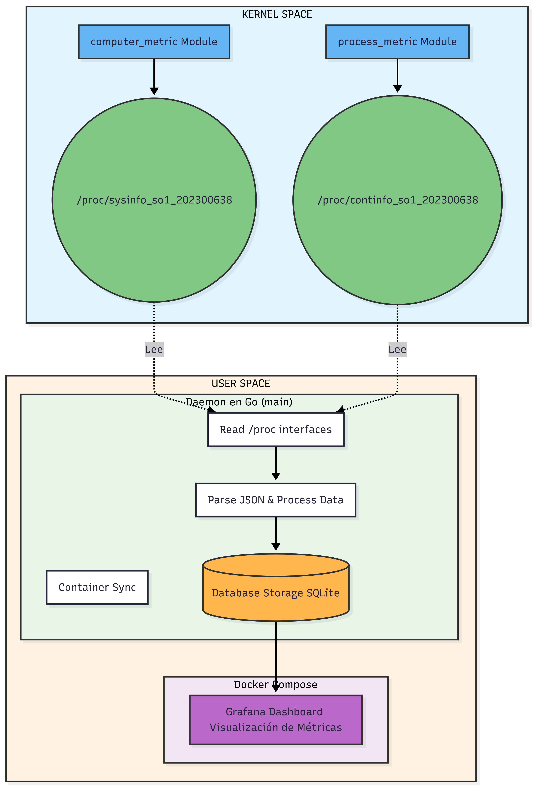
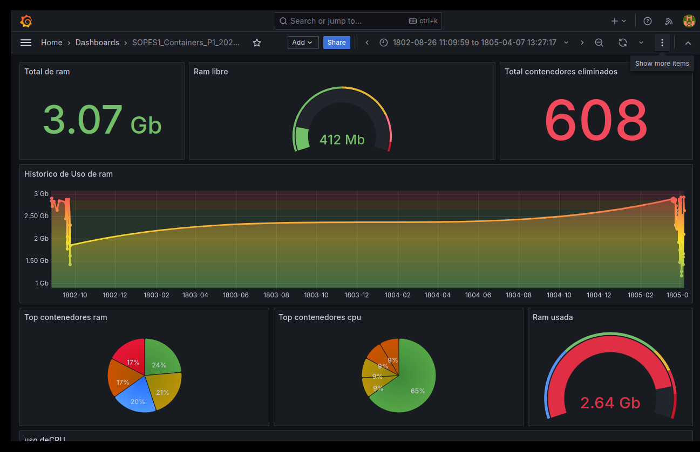

# MANUAL DE USUARIO - SISTEMA DE MONITOREO DE CONTENEDORES

## Proyecto SOPES1 - Carnet: 202300638

---

## Tabla de Contenidos

1. [Introducción](#1-introducción)
2. [Requisitos del Sistema](#2-requisitos-del-sistema)
3. [Guía de Instalación](#3-guía-de-instalación)
4. [Arquitectura del Sistema](#4-arquitectura-del-sistema)
5. [Inicio del Sistema](#5-inicio-del-sistema)
6. [Acceso al Dashboard de Grafana](#6-acceso-al-dashboard-de-grafana)
7. [Ejemplos de Uso](#7-ejemplos-de-uso)
8. [Preguntas Frecuentes](#8-preguntas-frecuentes)
9. [Solución de Problemas](#9-solución-de-problemas)

---

## 1. Introducción

### ¿Qué es este sistema?

El Sistema de Monitoreo de Contenedores es una herramienta que permite visualizar en tiempo real el estado y consumo de recursos de contenedores Docker ejecutándose en su sistema Linux.

### ¿Para qué sirve?

- **Monitorear recursos del sistema**: Ver uso de RAM, CPU, espacio en disco
- **Supervisar contenedores Docker**: Conocer qué contenedores están activos y cuántos recursos consumen
- **Visualizar históricos**: Ver gráficas del comportamiento del sistema a lo largo del tiempo
- **Detectar problemas**: Identificar contenedores que consumen demasiados recursos

### ¿Quién puede usar este sistema?

Este sistema está diseñado para:

- Administradores de sistemas Linux
- Desarrolladores que trabajan con Docker
- Estudiantes de sistemas operativos
- Cualquier persona que necesite monitorear contenedores

---

## 2. Requisitos del Sistema

### 2.1 Hardware Mínimo Requerido

| Componente              | Mínimo                     | Recomendado     |
| ----------------------- | -------------------------- | --------------- |
| **Procesador**          | 2 núcleos                  | 4 núcleos o más |
| **Memoria RAM**         | 4 GB                       | 8 GB o más      |
| **Espacio en Disco**    | 10 GB libres               | 20 GB o más     |
| **Conexión a Internet** | Requerida para instalación | Requerida       |

### 2.2 Software Requerido

| Software              | Versión Mínima           | Propósito               |
| --------------------- | ------------------------ | ----------------------- |
| **Sistema Operativo** | Ubuntu 20.04 / Debian 11 | Linux compatible        |
| **Kernel Linux**      | 5.0 o superior           | Para módulos del kernel |
| **Docker**            | 20.10 o superior         | Gestión de contenedores |
| **Docker Compose**    | 2.0 o superior           | Orquestación            |
| **Go (Golang)**       | 1.19 o superior          | Compilación del daemon  |

### 2.3 Verificar Requisitos

Puede verificar si su sistema cumple los requisitos ejecutando:

```bash
# Verificar versión del sistema
cat /etc/os-release

# Verificar versión del kernel
uname -r

# Verificar Docker
docker --version

# Verificar Docker Compose
docker compose version

# Verificar Go
go version
```

**Ejemplo de salida correcta:**

```
PRETTY_NAME="Ubuntu 22.04 LTS"
6.5.0-14-generic
Docker version 24.0.7
Docker Compose version v2.21.0
go version go1.21.4 linux/amd64
```

---

## 3. Guía de Instalación

### 3.1 Instalación Completa Paso a Paso

#### Paso 1: Actualizar el Sistema

```bash
# Actualizar lista de paquetes
sudo apt update

# Actualizar paquetes instalados
sudo apt upgrade -y
```

**Tiempo estimado:** 5-10 minutos

---

#### Paso 2: Instalar Dependencias

```bash
# Instalar herramientas de compilación
sudo apt install -y build-essential

# Instalar headers del kernel
sudo apt install -y linux-headers-$(uname -r)

# Instalar Go
sudo apt install -y golang-go

# Instalar Docker
sudo apt install -y docker.io docker-compose

# Instalar herramientas adicionales
sudo apt install -y git curl jq
```

**Tiempo estimado:** 10-15 minutos

**Verificación:**

```bash
# Debería mostrar las versiones instaladas
gcc --version
go version
docker --version
```

---

#### Paso 3: Configurar Docker

```bash
# Agregar su usuario al grupo docker (para no usar sudo)
sudo usermod -aG docker $USER

# Iniciar servicio Docker
sudo systemctl start docker

# Habilitar Docker al inicio
sudo systemctl enable docker

# Verificar que Docker funciona
docker run hello-world
```

**⚠️ IMPORTANTE:** Después de agregar su usuario al grupo docker, debe cerrar sesión y volver a iniciarla para que los cambios surtan efecto.

---

#### Paso 4: Descargar el Proyecto

```bash
# Ir al directorio de documentos (o donde prefiera)
cd ~/Documentos

# Clonar o descargar el proyecto
# (Ajustar según su método de obtención del código)

# Ingresar al directorio del proyecto
cd SOPES1_P1_202300638
```

---

#### Paso 5: Compilar el Proyecto

```bash
# Dar permisos de ejecución al script de compilación
chmod +x build.sh

# Ejecutar compilación
./build.sh
```

**Salida esperada:**

```
=== Iniciando Compilación ===

[1/3] Compilando computer_metric...
✓ computer_metric compilado

[2/3] Compilando process_metric...
✓ process_metric compilado

[3/3] Compilando daemon Go...
✓ Daemon compilado

=== Compilación Completada ===
Para ejecutar: sudo ./main
```

**Tiempo estimado:** 2-5 minutos

---

#### Paso 6: Verificar la Compilación

```bash
# Verificar que los archivos se compilaron correctamente
ls -lh kernel_modules/metric_computer_module/computer_metric.ko
ls -lh kernel_modules/metric_process_module/process_metric.ko
ls -lh main
```

**Salida esperada:**

```
-rw-r--r-- 1 user user 16K computer_metric.ko
-rw-r--r-- 1 user user 24K process_metric.ko
-rwxr-xr-x 1 user user 12M main
```

---

### 3.2 Configuración Inicial

#### Crear Directorios Necesarios

```bash
# El sistema creará automáticamente estos directorios al iniciarse
# Pero puede crearlos manualmente si lo desea:

mkdir -p database
mkdir -p logs
mkdir -p connexionDB/grafana-data
```

---

## 4. Arquitectura del Sistema

### 4.1 ¿Cómo Funciona el Sistema?

El sistema está compuesto por tres partes principales que trabajan juntas:



### 4.2 Componentes del Sistema

#### 1. Módulos del Kernel (Invisible para el usuario)

Los módulos son pequeños programas que se insertan en el núcleo de Linux para obtener información directamente del sistema operativo.

- **Módulo Computer:** Obtiene información de memoria RAM y CPU
- **Módulo Process:** Obtiene información de todos los procesos y contenedores

**Analogía:** Son como sensores que miden constantemente el pulso del sistema.

---

#### 2. Daemon (Programa Principal)

El daemon es el "cerebro" del sistema. Se ejecuta en segundo plano y:

- Lee la información de los módulos
- La procesa y organiza
- La guarda en una base de datos
- Coordina todo el sistema

**Analogía:** Es como un doctor que constantemente revisa los sensores y anota los resultados en un historial médico.

---

#### 3. Base de Datos SQLite

Almacena todo el histórico de información para poder ver:

- Cómo ha cambiado el uso de recursos en el tiempo
- Cuándo se crearon o eliminaron contenedores
- Tendencias y patrones de uso

---

#### 4. Grafana (Dashboard)

Es la interfaz visual donde usted puede ver toda la información en forma de:

- Gráficas de líneas
- Tablas
- Indicadores
- Alertas

**Analogía:** Es como el tablero de instrumentos de un auto, donde ve velocidad, temperatura, gasolina, etc.

---

### 4.3 Flujo de Datos

```
1. Los MÓDULOS extraen datos del sistema cada vez que se solicitan
                         ↓
2. El DAEMON lee esos datos cada 5 segundos
                         ↓
3. El DAEMON guarda los datos en la BASE DE DATOS
                         ↓
4. GRAFANA lee la base de datos y muestra gráficas actualizadas
                         ↓
5. USTED ve las gráficas en su navegador web
```

---

## 5. Inicio del Sistema

### 5.1 Iniciar el Sistema por Primera Vez

Siga estos pasos en orden para iniciar el sistema correctamente:

#### Paso 1: Cargar los Módulos del Kernel

```bash
# Navegar al directorio del proyecto
cd ~/Documentos/SOPES1_P1_202300638

# Cargar módulo de información del sistema
sudo insmod kernel_modules/metric_computer_module/computer_metric.ko

# Cargar módulo de procesos
sudo insmod kernel_modules/metric_process_module/process_metric.ko
```

**Verificar que se cargaron correctamente:**

```bash
# Debe mostrar los dos módulos
lsmod | grep -E "computer_metric|process_metric"
```

**Salida esperada:**

```
process_metric         16384  0
computer_metric        16384  0
```

---

#### Paso 2: Verificar Archivos en /proc

```bash
# Verificar que se crearon los archivos virtuales
ls -l /proc/sysinfo_so1_202300638
ls -l /proc/continfo_so1_202300638
```

**Salida esperada:**

```
-r--r--r-- 1 root root 0 /proc/sysinfo_so1_202300638
-r--r--r-- 1 root root 0 /proc/continfo_so1_202300638
```

**Probar lectura:**

```bash
# Ver información del sistema (debe mostrar JSON)
cat /proc/sysinfo_so1_202300638
```

---

#### Paso 3: Iniciar el Daemon

```bash
# Opción 1: Ejecutar en primer plano (para ver logs)
sudo ./main

# Opción 2: Ejecutar en segundo plano (recomendado)
sudo nohup ./main > logs/daemon.log 2>&1 &
```

**Verificar que está ejecutándose:**

```bash
ps aux | grep main
```

---

#### Paso 4: Verificar Grafana

```bash
# Verificar que Grafana esté corriendo
docker ps | grep grafana
```

**Salida esperada:**

```
abc123def456  grafana/grafana  Up 2 minutes  0.0.0.0:3000->3000/tcp  grafana_monitoring
```

---

### 5.2 Detener el Sistema

Para detener el sistema de forma segura:

```bash
# 1. Detener el daemon
sudo pkill -f "main"

# 2. Descargar módulos del kernel
sudo rmmod process_metric
sudo rmmod computer_metric

# 3. Detener Grafana (opcional)
docker compose -f connexionDB/docker-compose.yml down
```

---

## 6. Acceso al Dashboard de Grafana

### 6.1 Abrir Grafana en el Navegador

#### Paso 1: Abrir su Navegador Web

Puede usar cualquier navegador moderno:

- Google Chrome
- Mozilla Firefox
- Microsoft Edge
- Safari

---

#### Paso 2: Acceder a la URL de Grafana

En la barra de direcciones, escriba:

```
http://localhost:3000
```

O si está accediendo desde otra computadora en la red local:

```
http://[IP-DEL-SERVIDOR]:3000
```

**[CAPTURA: Página de Login de Grafana]**

_Espacio para captura de pantalla_

---

### 6.2 Iniciar Sesión en Grafana

#### Credenciales de Acceso

```
Usuario:    admin
Contraseña: admin
```

**Pasos:**

1. Ingrese `admin` en el campo "Usuario" (Email or username)
2. Ingrese `admin` en el campo "Contraseña" (Password)
3. Haga clic en "Log in"

**[CAPTURA: Formulario de Login]**

_Espacio para captura de pantalla_

---

#### Primera Vez - Cambiar Contraseña

La primera vez que inicie sesión, Grafana le pedirá cambiar la contraseña:

1. **Opción 1:** Cambiar la contraseña (recomendado)

   - Ingrese una nueva contraseña segura
   - Confirme la contraseña
   - Haga clic en "Submit"

2. **Opción 2:** Saltar (Skip)
   - Haga clic en "Skip" para mantener la contraseña por defecto
   - **⚠️ No recomendado en producción**

**[CAPTURA: Cambio de Contraseña]**

_Espacio para captura de pantalla_

---

### 6.3 Interfaz Principal de Grafana

Una vez que inicie sesión, verá la página principal de Grafana.

**[CAPTURA: Home Page de Grafana]**



### 6.4 Configurar Fuente de Datos (Data Source)

### 7.4 Caso de Uso 4: Verificar Contenedores Generados

#### Escenario

Tiene configurado el sistema para generar contenedores automáticamente y quiere verificar que funciona.

#### Pasos

1. **Esperar 2-3 minutos** (el cronjob ejecuta cada minuto)
2. **Verificar en terminal:**

```bash
# Ver contenedores nuevos
docker ps --format "table {{.Names}}\t{{.Status}}" | grep container_
```

3. **Ver en Grafana:**
   - Panel de "Contenedores Activos"
   - El contador debería ir aumentando

**[CAPTURA: Aumento de Contenedores]**

_Espacio para captura de pantalla_

---

### 7.5 Caso de Uso 5: Limpiar Sistema Saturado

#### Escenario

El sistema generó demasiados contenedores y se está quedando sin recursos.

#### Síntomas

- Sistema lento
- RAM > 90%
- Disco casi lleno

#### Solución Rápida

```bash
# 1. Detener generación automática
crontab -r

# 2. Detener todos los contenedores generados
docker stop $(docker ps -q --filter "name=container_")

# 3. Eliminar contenedores detenidos
docker rm $(docker ps -aq --filter "name=container_")

# 4. Limpiar volúmenes huérfanos
docker volume prune -f

# 5. Limpiar imágenes no usadas
docker image prune -a -f
```

**Verificar en Grafana:**

- El uso de RAM debería bajar
- El número de contenedores activos debería ser 0 (o solo Grafana)

**[CAPTURA: Sistema Después de Limpieza]**

_Espacio para captura de pantalla_

---

### 8.2 Uso del Sistema

**P: ¿Cada cuánto se actualizan los datos?**

R: El daemon lee datos cada 5 segundos. En Grafana, puede configurar el refresco automático a 5s, 10s, 30s, etc.

---

**P: ¿Cuánto espacio en disco usa el sistema?**

R: Depende del tiempo de ejecución:

- Base de datos SQLite: ~10-50 MB por día
- Logs: ~5-10 MB por día
- Contenedores Docker: Variable (100MB - varios GB)

**Recomendación:** Limpiar datos antiguos cada semana.

---

**P: ¿Puedo monitorear contenedores creados manualmente?**

R: Sí, el sistema monitorea **todos** los contenedores Docker en el sistema, no solo los que genera automáticamente.

---

**P: ¿Los módulos del kernel son peligrosos?**

R: Los módulos están diseñados para solo **leer** información, no modifican nada. Sin embargo:

- Solo cárguelos si confía en el código fuente
- Pueden causar inestabilidad si están mal programados
- Use `sudo rmmod` para descargarlos si hay problemas

---

### 8.4 Rendimiento

**P: El sistema está muy lento, ¿qué hago?**

R: Posibles causas y soluciones:

1. **Muchos contenedores:**

   ```bash
   docker ps -q | wc -l  # Ver cantidad
   docker stop $(docker ps -q | tail -20)  # Detener últimos 20
   ```

2. **Base de datos grande:**

   ```bash
   # Limpiar datos antiguos (>7 días)
   sqlite3 database/metrics.db "DELETE FROM system_metrics WHERE timestamp < datetime('now', '-7 days');"
   ```

3. **Memoria insuficiente:**
   - Cerrar aplicaciones innecesarias
   - Aumentar RAM del sistema
   - Reducir contenedores activos

---

**P: ¿Cuántos contenedores puede manejar el sistema?**

R: Depende de los recursos de su máquina:

- **4GB RAM:** Máximo 20-30 contenedores pequeños
- **8GB RAM:** Máximo 50-70 contenedores
- **16GB+ RAM:** 100+ contenedores

El sistema tiene configurado un límite de 50 por defecto.

---

### 9.2 Problemas Durante la Ejecución

#### Problema: El daemon se detiene solo

**Síntomas:**

- `ps aux | grep main` no muestra nada
- Grafana no recibe datos nuevos

**Solución:**

```bash
# Ver logs para identificar el error
tail -50 logs/daemon.log

# Causas comunes:
# 1. Falta de permisos
sudo ./main

# 2. Módulos desconectados
sudo insmod kernel_modules/metric_computer_module/computer_metric.ko
sudo insmod kernel_modules/metric_process_module/process_metric.ko

# 3. Base de datos corrupta
rm database/metrics.db  # ¡Perderá datos!
./main
```

---

#### Problema: Contenedores no aparecen en Grafana

**Verificaciones:**

```bash
# 1. ¿Hay contenedores corriendo?
docker ps

# 2. ¿El daemon está leyendo correctamente?
cat /proc/continfo_so1_202300638

# 3. ¿Grafana está conectado a la BD?
# En Grafana: Configuration → Data Sources → Test
```

---

#### Problema: Sistema muy lento

**Diagnóstico:**

```bash
# Ver uso de recursos
top
htop  # Si está instalado

# Ver uso de disco
df -h

# Ver contenedores y su consumo
docker stats
```

**Soluciones:**

1. **Limpiar contenedores:**

   ```bash
   docker system prune -a --volumes -f
   ```

2. **Limpiar base de datos:**

   ```bash
   sqlite3 database/metrics.db "VACUUM;"
   ```

3. **Reducir frecuencia de monitoreo:**
   Editar `main.go` y cambiar:
   ```go
   ticker := time.NewTicker(10 * time.Second)  // De 5s a 10s
   ```

---

## Apéndice A: Referencia Rápida de Comandos

### Iniciar el Sistema

```bash
# 1. Cargar módulos
sudo insmod kernel_modules/metric_computer_module/computer_metric.ko
sudo insmod kernel_modules/metric_process_module/process_metric.ko

# 2. Iniciar daemon
sudo nohup ./main > logs/daemon.log 2>&1 &

# 3. Verificar Grafana
docker ps | grep grafana
```

### Detener el Sistema

```bash
sudo pkill -f "main"
sudo rmmod process_metric computer_metric
docker compose -f connexionDB/docker-compose.yml down
```

### Monitoreo

```bash
# Ver logs
tail -f logs/daemon.log

# Ver contenedores
docker ps

# Ver uso de recursos
docker stats

# Ver módulos cargados
lsmod | grep metric
```

### Limpieza

```bash
# Contenedores
docker stop $(docker ps -aq)
docker rm $(docker ps -aq)

# Volúmenes
docker volume prune -f

# Imágenes
docker image prune -a -f

# Base de datos antigua
sqlite3 database/metrics.db "DELETE FROM system_metrics WHERE timestamp < datetime('now', '-7 days');"
```

---

**¡Gracias por usar el Sistema de Monitoreo de Contenedores!**
